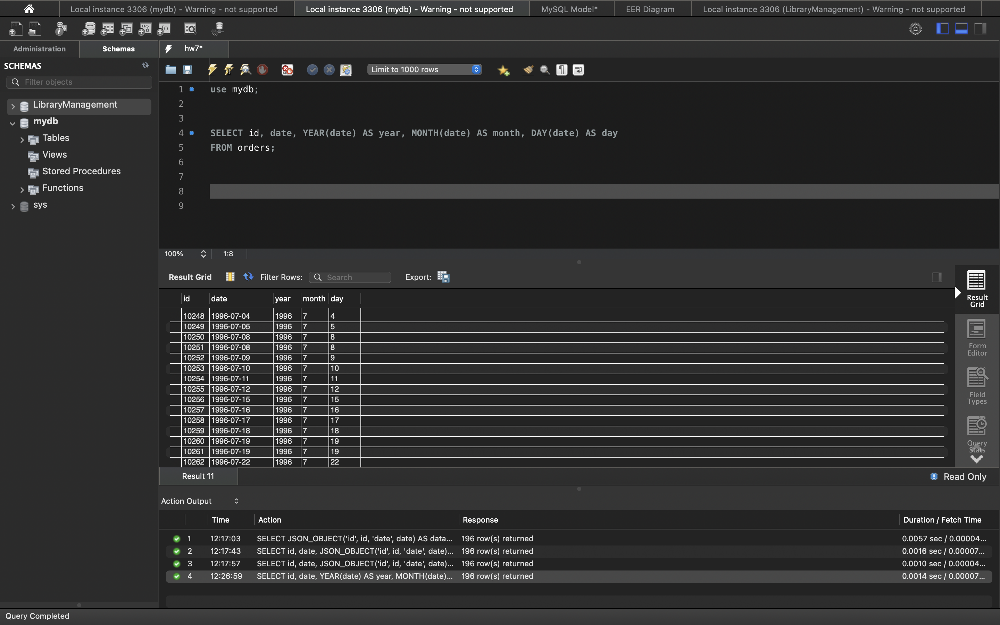
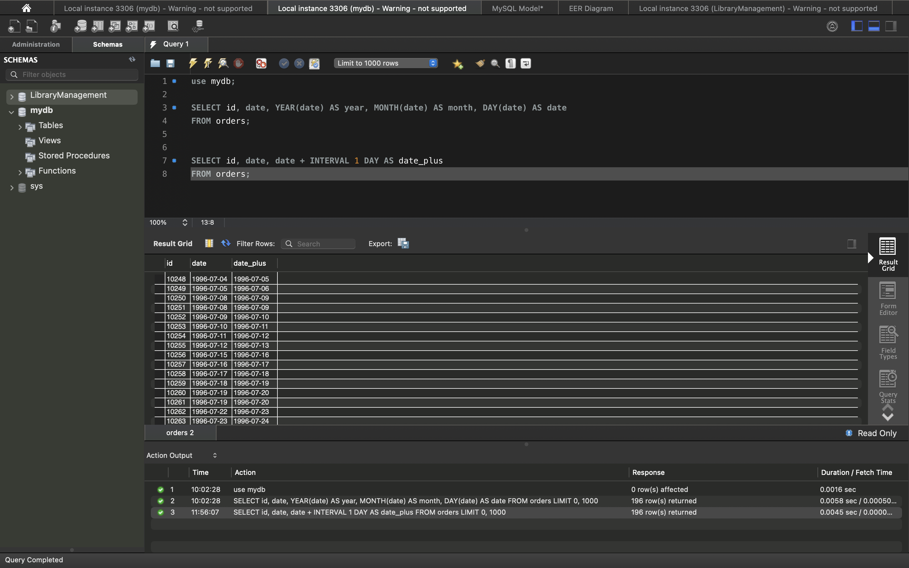
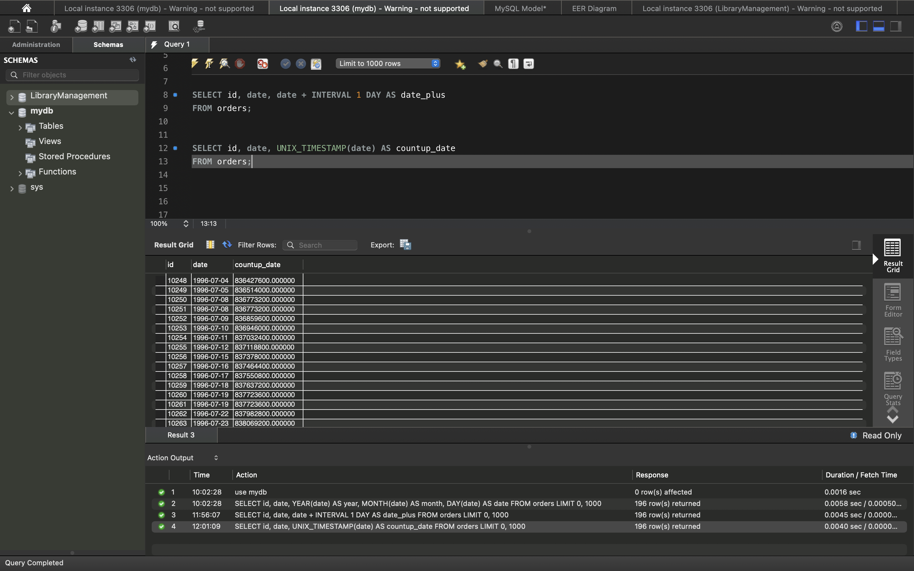
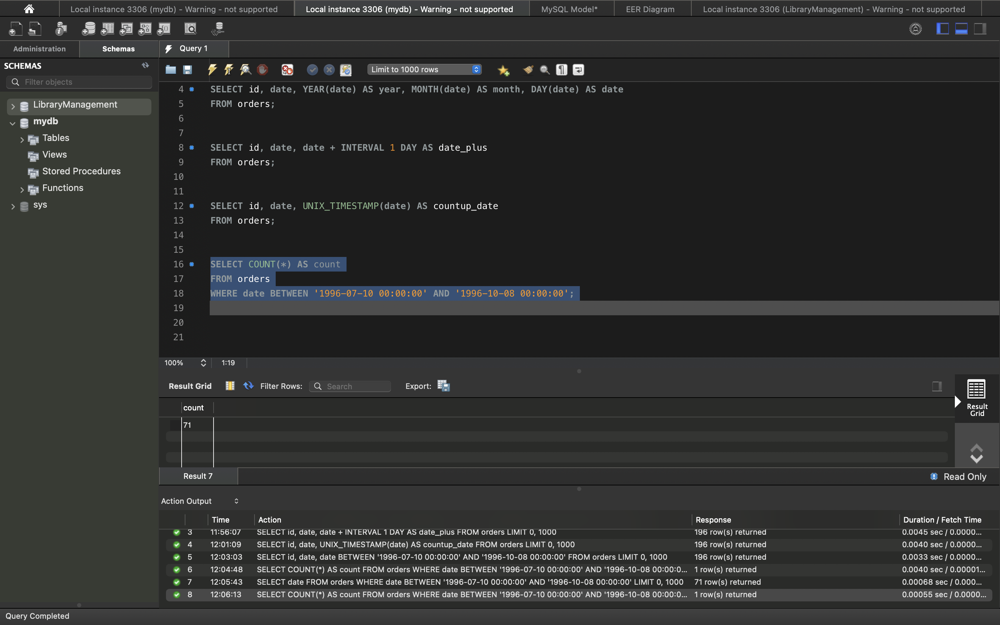
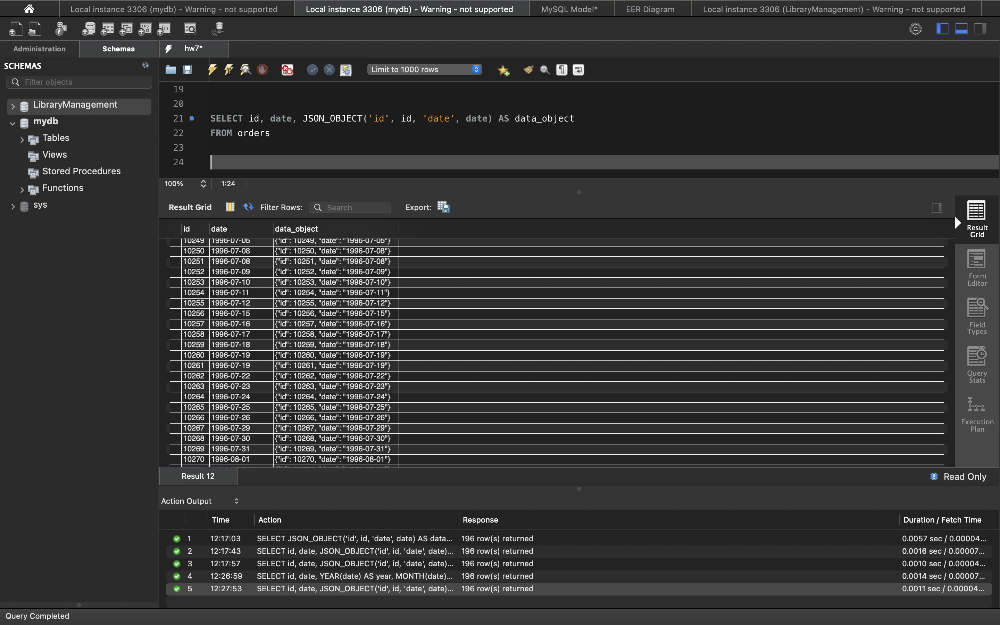

# goit-rdb-hw-07

🇺🇦 [Українська](#-українська) | 🇬🇧 [English](#-english)

---

## 🇺🇦 Українська

### Опис

Домашнє завдання №7 з курсу реляційних баз даних. Робота з функціями дати/часу та JSON у MySQL на таблиці `orders` бази `mydb`.

### Структура проєкту

| Файл | Опис |
|------|------|
| `hw7.sql` | SQL-запити для всіх 5 завдань |
| `p1.png` – `p5.png` | Скриншоти результатів виконання запитів 1–5 |

### Завдання

1. **Рік, місяць, число** — з атрибута `date` витягуються рік, місяць і день (`YEAR()`, `MONTH()`, `DAY()`); виводяться `id`, `date` та три нові атрибути (всього 5).
2. **Додавання одного дня** — `date + INTERVAL 1 DAY`; виводяться `id`, `date` та результат.
3. **Unix timestamp** — функція `UNIX_TIMESTAMP()`; виводяться `id`, `date` та кількість секунд з початку відліку.
4. **Підрахунок рядків у діапазоні** — `COUNT(*)` з умовою `BETWEEN '1996-07-10 00:00:00' AND '1996-10-08 00:00:00'` (межі включно).
5. **JSON-об'єкт** — функція `JSON_OBJECT('id', id, 'date', date)`; виводяться `id`, `date` та JSON `{"id": ..., "date": ...}`.

### Запити

```sql
USE mydb;

-- 1
SELECT id, date, YEAR(date) AS year, MONTH(date) AS month, DAY(date) AS day
FROM orders;

-- 2
SELECT id, date, date + INTERVAL 1 DAY AS date_plus
FROM orders;

-- 3
SELECT id, date, UNIX_TIMESTAMP(date) AS countup_date
FROM orders;

-- 4
SELECT COUNT(*) AS count
FROM orders
WHERE date BETWEEN '1996-07-10 00:00:00' AND '1996-10-08 00:00:00';

-- 5
SELECT id, date, JSON_OBJECT('id', id, 'date', date) AS data_object
FROM orders;
```

### Результати

| Завдання | Скриншот |
|----------|----------|
| 1 |  |
| 2 |  |
| 3 |  |
| 4 |  |
| 5 |  |

### Запуск

```bash
mysql -u <user> -p < hw7.sql
```

або відкрити `hw7.sql` у MySQL Workbench і виконати запити по черзі.

---

## 🇬🇧 English

### Description

Homework #7 for the relational databases course. Working with date/time and JSON functions in MySQL on the `orders` table of the `mydb` database.

### Project structure

| File | Description |
|------|-------------|
| `hw7.sql` | SQL queries for all 5 tasks |
| `p1.png` – `p5.png` | Screenshots of the results of queries 1–5 |

### Tasks

1. **Year, month, day** — extract year, month and day from the `date` attribute (`YEAR()`, `MONTH()`, `DAY()`); output `id`, `date` and the three new attributes (5 columns in total).
2. **Add one day** — `date + INTERVAL 1 DAY`; output `id`, `date` and the result.
3. **Unix timestamp** — the `UNIX_TIMESTAMP()` function; output `id`, `date` and the number of seconds since the epoch.
4. **Count rows in a range** — `COUNT(*)` with `BETWEEN '1996-07-10 00:00:00' AND '1996-10-08 00:00:00'` (bounds inclusive).
5. **JSON object** — the `JSON_OBJECT('id', id, 'date', date)` function; output `id`, `date` and the JSON `{"id": ..., "date": ...}`.

### Queries

```sql
USE mydb;

-- 1
SELECT id, date, YEAR(date) AS year, MONTH(date) AS month, DAY(date) AS day
FROM orders;

-- 2
SELECT id, date, date + INTERVAL 1 DAY AS date_plus
FROM orders;

-- 3
SELECT id, date, UNIX_TIMESTAMP(date) AS countup_date
FROM orders;

-- 4
SELECT COUNT(*) AS count
FROM orders
WHERE date BETWEEN '1996-07-10 00:00:00' AND '1996-10-08 00:00:00';

-- 5
SELECT id, date, JSON_OBJECT('id', id, 'date', date) AS data_object
FROM orders;
```

### Results

| Task | Screenshot |
|------|------------|
| 1 |  |
| 2 |  |
| 3 |  |
| 4 |  |
| 5 |  |

### How to run

```bash
mysql -u <user> -p < hw7.sql
```

or open `hw7.sql` in MySQL Workbench and run the queries one by one.
